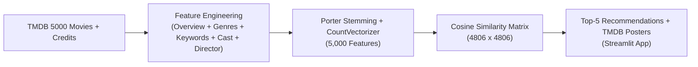

# Movie Recommendation System


A **Content-Based Movie Recommendation System** trained on the **TMDB 5000 Movies & Credits** dataset and served through a styled **Streamlit** web application with live movie posters fetched via the **TMDB API**.

---

## Key Features

- **Content-Based Filtering**: Combines movie `overview`, `genres`, `keywords`, top 3 `cast` members, and the `Director` from `crew` into a unified metadata `tags` representation for 4,800+ films.
- **NLP & Vectorization Pipeline**: Applies NLTK Porter stemming (`PorterStemmer`) and Bag-of-Words vectorization (`CountVectorizer(max_features=5000, stop_words='english')`) to embed each movie in a 5,000-dimensional feature space.
- **Cosine Similarity Ranking**: Computes pairwise cosine similarity across all movies (`similarity.pkl.zip`) to retrieve the top 5 most similar films in milliseconds.
- **Interactive Streamlit Web UI**: Custom dark-mode UI (`#2E3440` Nord palette) that displays the top 5 recommended movies alongside high-resolution posters fetched dynamically from The Movie Database (TMDB) API.

---

## Recommendation Pipeline



---

## Project Structure

```text
Movie-Recommendation-System/
├── app.py                        # Streamlit web application (auto-loads similarity.pkl.zip)
├── movies.pkl                    # Processed movie DataFrame
├── movies_dict.pkl               # Serialized movie dictionary for Streamlit selector
├── similarity.pkl.zip            # Compressed pairwise cosine similarity matrix
├── tmdb_5000_movies.csv          # TMDB 5000 movies metadata dataset
├── tmdb_5000_credits.csv         # TMDB 5000 cast and crew dataset
├── notebooks/
│   └── MRS.ipynb                 # End-to-end data preprocessing & similarity model notebook
└── requirements.txt              # Python package dependencies
```

---

## Getting Started

### 1. Clone the Repository

```bash
git clone https://github.com/ysri10/Movie-Recommendation-System.git
cd Movie-Recommendation-System
```

### 2. Create a Virtual Environment & Install Dependencies

```bash
python -m venv venv
source venv/bin/activate  # On Windows: venv\Scripts\activate
pip install -r requirements.txt
```

### 3. Run the Streamlit Application

```bash
streamlit run app.py
```

> **Note:** `app.py` automatically reads `similarity.pkl` directly from `similarity.pkl.zip`, so no manual unzipping is required.

Open `http://localhost:8501` in your browser, select any movie from the dropdown, and click **Recommend** to view the top 5 recommendations and posters.
